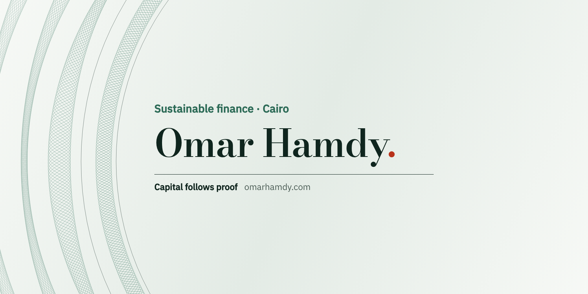

Sustainable finance specialist in Cairo, on the lender's side of EBRD and IFC credit lines. IFC EDGE Expert. MSc Business Analytics.

I write [Condition Precedent](https://conditionprecedent.substack.com/?utm_source=github), a newsletter in English and Arabic on what a lender has to prove before green money moves. The tools below come from the same desk: if a check runs twice by hand, I build it once in code.

### Open data and tools

| | |
|---|---|
| [**cbam-egypt-data**](https://github.com/Omarhamdii87/cbam-egypt-data) | CBAM default values for Egypt on 260 CN lines, with 2025 EU imports and a tested certificate formula. CC BY 4.0, [DOI 10.5281/zenodo.23898572](https://doi.org/10.5281/zenodo.23898572) |
| [**CBAM cost calculator**](https://omarhamdy.com/cbam-calculator/?src=github) | Certificates and cost for urea, ammonia, aluminium, cement and steel, on the EU default and on verified data |
| [**CBAM readiness check**](https://omarhamdy.com/cbam-check/?src=github) | Five questions that show what an EU buyer will ask an exporter for. Runs in the browser |
| [**Rules tracker**](https://omarhamdy.com/tracker/?src=github) | Sustainable finance rules for Egypt, six Gulf states and EU CBAM, each with its official source and a change log |
| [**Toolkit**](https://omarhamdy.com/toolkit/?src=github) | Checklists and worksheets for lenders, built from public standards |

### Read

- [Condition Precedent](https://conditionprecedent.substack.com/?utm_source=github), English, every Tuesday
- [الشرط المسبق](https://alshart.substack.com/?utm_source=github), Arabic, every other Tuesday
- [Guides](https://omarhamdy.com/guides/?src=github) on CBAM, ESMS, PCAF, green buildings and IFRS S1 and S2

### Find me

[omarhamdy.com](https://omarhamdy.com/?src=github-readme) · [LinkedIn](https://www.linkedin.com/in/omrhamdy) · [ORCID 0009-0007-6613-8968](https://orcid.org/0009-0007-6613-8968) · [Book a 30-minute call](https://calendly.com/omar-omarhamdy/30min?utm_source=github)

Views are my own.
